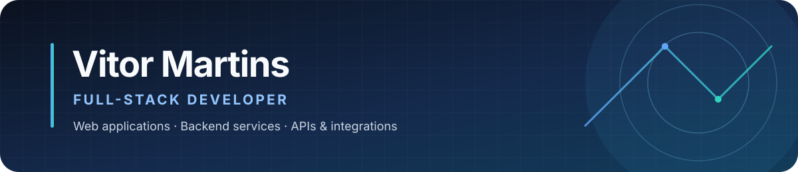

  
   
  
  
  

## About

Full-Stack Developer experienced in building and maintaining web applications, backend services and integrations. I work across frontend, APIs, databases, automation and production environments, connecting technical solutions to real business workflows.

## Technology Overview

**Frontend & UI**

**Backend & APIs**

**Databases & Infrastructure**

**Development Tools**

  
  
  
  
  
  
  
  

## Professional Experience

**Aliança — Full-Stack Development**  
Development and maintenance of campaign landing pages, lead-capture flows, backend APIs and analytics dashboards. Work included tracking, attribution, business rules, external integrations and production deployments.

**Alianza — Education & Business Platforms**  
Development and evolution of internal platforms supporting student, teacher, class, contract and commercial operations, including dashboards, access management, APIs and workflow automation.

---

  Building useful software, reliable integrations and maintainable systems.

